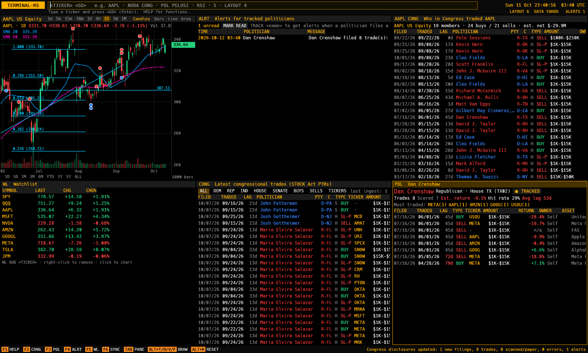
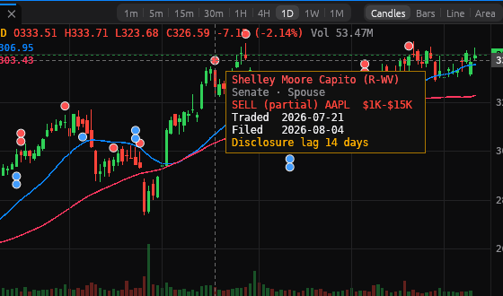

# terminal-rs

A fast, keyboard-driven market terminal in pure Rust: TradingView-class GPU charting with a
Bloomberg Terminal look (black background, amber monospace, dense tiled panes, a command line
like `AAPL <GO>`) across **stocks, ETFs, indices, FX, crypto, US Treasuries and futures/commodities**,
plus **congressional trade tracking ingested directly from the official STOCK Act disclosure
systems**.



> **Built from reverse-engineering research.** Chart UX was studied behaviourally on
> tradingview.com with [REA](https://github.com/morluto/rea) in website mode (passive captures of
> the public, logged-out chart page). Findings, evidence IDs and their design implications are in
> [`docs/analysis/`](docs/analysis/README.md). Only behaviour was studied: no TradingView code,
> scripts, icons, fonts or other assets are used or included here. The disclosure parsers were
> likewise built by examining the public Senate eFD and House Clerk sites and their filings.

## Features

- **Multi-asset with Bloomberg-style market keys** — `AAPL <EQUITY>`, `SPY <EQUITY>`,
  `SPX <INDEX>`, `BTCUSD <CRNCY>`, `EURUSD <CRNCY>`, `US10Y <GOVT>`, `CL1 <CMDTY>` (keys display
  as `AAPL US Equity`, `BTCUSD Curncy`, `US10Y Govt`, `CL1 Comdty`). The yellow key is optional for
  known tickers. A built-in catalog covers ~120 instruments (regional indices, equity index futures,
  energy/metals/grains, the full Treasury curve, majors and crosses, top crypto, popular ETFs and
  large caps); anything else resolves by convention.
- **Symbol search everywhere** — typing in the command line shows matches across all asset classes
  (catalog instantly, plus Yahoo search after a short pause); ↑/↓, Tab, Enter. `SECF gold cmdty`
  opens a full search panel.
- **WEI world markets** (`WEI`) — Americas/EMEA/Asia-Pacific indices, equity futures, Treasuries,
  currencies, crypto and commodities with last, net and percent change (bp for yields) and
  sparklines, refreshed every 20 s.
- **Yield curve** (`GC`) — the US Treasury par curve now vs one month and one year ago, tenor
  table with bp changes and 2s10s / 3m10y / 5s30s spreads.
- **Live crypto charts** — Binance kline websocket (Coinbase ticker channel as fallback) updates
  the forming bar in real time; charts show a LIVE badge.
- **Command line** — `<SECURITY> [<FUNCTION>] <GO>` (Enter is `<GO>`); typing anywhere starts a
  command, with a live interpretation underneath (`5` → "Interval 5 minutes"). History with ↑/↓.
- **Tiling layouts** — `LAYOUT 1|2|2H|3|4|6`, Tab to cycle focus; any pane can be a chart, the
  congress feed, a per-ticker list, a politician profile, the politician directory, alerts, a
  watchlist or help. Layout, watchlist, charts, indicators and drawings persist between runs.
- **Charts** — candles, OHLC bars, line and area; 1m, 5m, 15m, 30m, 1H, 4H, 1D, 1W, 1M plus quick
  ranges (1D … ALL); volume overlay; SMA, EMA, VWAP, Bollinger overlays; RSI and MACD sub-panes;
  `CMP <SYM>` compare rebased to the left edge of the view; log scale; crosshair with OHLC legend.
- **Drawings** — trendline (Alt+T), horizontal (Alt+H), vertical (Alt+V) and fib retracement
  (Alt+F), stored in (time, price) so they survive zoom and timeframe changes; magnet (Alt+M) snaps
  to OHLC; click to select, Del to remove.
- **Market data behind a trait** (`tr_data::MarketData`), routed per asset class to free sources:

  | Asset class | History | Quotes | Live |
  |---|---|---|---|
  | Crypto | Binance public REST (`data-api.binance.vision`, then `api.binance.com`), Coinbase Exchange fallback | Binance 24h ticker | Binance kline websocket, Coinbase ticker fallback |
  | US Treasuries | Treasury.gov daily par yield curve CSV (FRED fallback); Yahoo `^IRX/^FVX/^TNX/^TYX` intraday | Treasury.gov | — |
  | FX, indices, futures | Yahoo Finance (`EURUSD=X`, `^GSPC`, `CL=F`) | Yahoo spark (batched) | — |
  | Stocks, ETFs | Alpaca when `APCA_API_KEY_ID`/`APCA_API_SECRET_KEY` are set, else Yahoo | Yahoo spark | — |

  No keys are required. `TR_PROVIDER=sample` runs fully offline on deterministic, class-aware sample
  data (BTCUSD near 65,000, EURUSD near 1.09, US10Y near 4.2%) **with simulated live ticks**, and
  the live router falls back to sample data when a source is unreachable. Bars are cached in SQLite
  so charts paint from disk on start. Older history pages in as you scroll left.
- **Congress trades** (key feature)
  - Ingests Periodic Transaction Reports from the **Senate eFD** (efdsearch.senate.gov: agreement
    + CSRF session, DataTables search API, HTML transaction tables) and the **House Clerk**
    (disclosures-clerk.house.gov: yearly `{year}FD.zip` XML index, PTR PDFs parsed with pure-Rust
    text extraction). Scanned paper filings are detected and recorded as such.
  - Normalises politician, party, chamber, state, ticker, buy/sell, amount range, transaction date
    and filed date into SQLite. Party comes from the official rosters (clerk.house.gov
    `MemberData.xml`, senate.gov `senators_cfm.xml`); politicians are keyed by bioguide ID, which
    also repairs typos in the source index.
  - Refreshed on a schedule (hourly by default, `TR_CONGRESS_REFRESH_MIN`, `0` disables;
    `REFRESH`/F6 forces one), incrementally — only unseen filings are fetched.
  - Panels: latest trades feed with party/chamber/side filters (`CONG`); per-ticker "who in
    Congress traded it" (`NVDA CONG`, or right-click any ticker); politician profile with trade
    history and **estimated performance** (amount-weighted directional return, hit rate, average
    disclosure lag) (`POL PELOSI`); directory (`POL`).
  - **Chart overlay**: B/S markers at transaction dates coloured by party (blue D, red R, purple
    I); hover for a card with politician, amount, owner, traded/filed dates and the disclosure lag.
  - **Alerts**: `TRACK <name>` (or ☆ in the directory/profile); when a tracked politician files a
    new PTR you get a toast, an `ALERTS n` badge and an entry in `ALERTS`.

- **Fully customizable workspace**
  - Free-form docking of any panel (chart, watchlist, news, order book, world markets, yield
    curve, Congress feed, politicians, alerts, search, settings, help): drag a tab onto a pane's
    centre to tab it or onto an edge to split, drag to a window edge to dock there, resize with
    dividers (double-click to equalise), tabs in every pane, and pop any pane out into its own
    native window (close it to dock back). Add panels from each pane's **+** menu or with
    `NEW <PANEL>` / `SPLIT [DOWN] <PANEL>`.
  - **Link groups**: give panes a colour (`LINK BLUE`, or the tab menu) and one security change
    drives every linked chart, order book, news and per-ticker Congress pane; clicking a row in a
    linked watchlist or world-markets pane loads it into the group.
  - **Saved layouts**: save, name, rename, duplicate, delete and switch (`LAYOUT <name>`, the
    sidebar list, ⌘1…⌘9); the active layout autosaves and is restored on launch. Each layout is
    a JSON file in `~/Library/Application Support/terminal-rs/layouts` (`$XDG_DATA_HOME` on
    Linux) and can be imported or exported (`LAYOUT EXPORT`/`IMPORT`, or Settings › Layouts).
  - **Preferences** (`PREFS`, persisted in `prefs.json`): light/dark/system theme, accent, up/down
    and highlight colours, interface and number fonts, text size and density (compact, regular,
    comfortable); every hotkey is rebindable; defaults for new charts and order books. Per-pane
    settings (chart type, indicators, drawings, filters, depth, link, tab title) save with the layout.
  - **News** (Yahoo headlines; CoinDesk for crypto) and **order book** depth (live Binance book,
    Coinbase fallback; markets without a free public book show a clearly marked simulation).
- **Native macOS feel** while keeping Bloomberg density and the command line: transparent title
  bar with the traffic lights inset in a unified toolbar, a translucent source-list sidebar with
  window vibrancy (`NSVisualEffectView` via `objc2`, in `crates/macos`) for the watchlist,
  markets and Congress, SF Pro for chrome and SF Mono for numbers, rounded cards, segmented
  controls with a sliding pill, spring animations (SwiftUI-style response/damping), hover states
  and context menus (chart, watchlist, feed rows). Light/dark follows the system appearance and
  the system accent colour; charts render at native retina scale with 4x MSAA.



## Running

```sh
cargo run --release                  # Yahoo data, congress ingest in the background
TR_PROVIDER=sample cargo run --release   # offline
APCA_API_KEY_ID=… APCA_API_SECRET_KEY=… cargo run --release   # Alpaca
```

Data lives in `~/Library/Application Support/terminal-rs` (macOS) or
`$XDG_DATA_HOME/terminal-rs` (Linux), or `TR_DATA_DIR`. The first congress ingest covers the
current and previous year (a few minutes; it runs in the background while you work).
`cargo run -p tr-congress --example ingest -- congress.sqlite3` runs one ingest from the CLI.

Appearance: `TR_THEME=light|dark` overrides the system appearance, `TR_MSAA=1|2|4|8` sets
chart anti-aliasing (default 4 on macOS), `TR_VIBRANCY=0` disables the translucent sidebar, and
⌃⌘S (Ctrl+Shift+S elsewhere) toggles the sidebar. `scripts/bundle-macos.sh` builds a retina-capable
`terminal-rs.app`.

Press **F1** (or type `HELP`) for the full command and hotkey list. Highlights:

| Input | Action |
|---|---|
| `AAPL` · `AAPL US EQUITY <GO>` | load a security in the focused chart |
| `BTCUSD <CRNCY>` · `EURUSD <CRNCY>` · `US10Y <GOVT>` · `CL1 <CMDTY>` · `SPX <INDEX>` | other asset classes |
| `WEI` · `GC` · `SECF <query>` | world markets · yield curve · security search |
| `5` `1H` `D` `1W` `1M` · `YTD` `5Y` `ALL` | interval · quick range |
| `RSI` `MACD` `BB` `SMA 50` `EMA 20` `VWAP` · `CLEAR` | toggle indicators |
| `CMP MSFT` · `LOG` · `CANDLE` `BAR` `LINE` `AREA` | compare · log scale · chart type |
| `CONG` · `NVDA CONG` · `POL PELOSI` · `TRACK PELOSI` · `ALERTS` | congress functions |
| wheel / drag / drag axes / double-click | zoom / pan / stretch / reset |
| Alt+T/H/V/F · Alt+R · Alt+L · Esc · Del | draw · reset view · log · cancel · delete drawing |
| F1–F6 · Tab · F12 | help, CONG, POL, ALRT, WL, SYNC · next pane · frame-time readout |
| `NEW BOOK` · `SPLIT DOWN NEWS` · `POP` · `LINK GREEN` · `TITLE Desk` | add, split, pop out, link, rename panes |
| `LAYOUT SAVE Macro` · `LAYOUT Macro` · `LAYOUT RENAME Rates` · `LAYOUT DUP` · `LAYOUT DEL` · `LAYOUT EXPORT` | saved layouts |
| `AAPL CN` · `BTCUSD CRNCY OB` · `PREFS` · `THEME LIGHT COMPACT` | news · order book · settings · theme |
| right-click chart / watchlist / feed row | context menu (chart type, indicators, draw, add to watchlist, who traded it) |

## Architecture

```
app/            eframe shell: command line, docked panes, chart widget, panels
  dock.rs       docking tree (splits + tab groups): insert/move/remove, layout, resize, presets
  layouts.rs    saved layout documents (JSON) and the layouts folder store
  prefs.rs      appearance, keymap and panel defaults (prefs.json)
  app/          workspace (drag and drop, pop-out windows, link groups), panels, settings, chrome
  worker.rs     tokio runtime: all network, SQLite, pyramid and indicator work (UI never blocks)
crates/core     Bar/Series, timeframes, market keys + security catalog, indicators, sample data
crates/data     MarketData trait; per-class router (Binance/Coinbase, Treasury.gov/FRED, Yahoo,
                Alpaca), websocket live feeds, sample provider with simulated ticks; bar cache
crates/chart    wgpu renderer, LOD pyramids, viewport math, axes, drawings, egui paint callback
crates/congress Senate eFD + House Clerk parsers, rosters, SQLite store, refresh, alerts, performance
docs/analysis   REA research notes on TradingView chart UX
```

**Rendering.** Bars are uploaded once per data version into a storage buffer as a level-of-detail
pyramid (level *k* merges 2^k bars), and geometry is generated in the vertex shader (one instance
per bar or line segment). Each frame picks the level that keeps instances at ≥ 2 px, so the work per
frame is bounded by the plot width, not the series length: a 1M-bar chart fully zoomed out draws
about 800 instances. Pan and zoom only rewrite a few hundred bytes of uniforms; bar indices are split
into integer and fraction for f32 precision at millions of bars. Axes, legend, crosshair, drawings and
markers are cheap egui shapes.

**Threading.** The UI thread sends requests to the worker and drains responses each frame; history
fetches, pyramid building (≈ 200 ms for 1M bars), indicators, SQLite queries and the congress ingest
all run on tokio tasks. The worker owns each chart's bar series, so initial history, paging and live
websocket ticks merge into one copy; live updates are coalesced to at most four GPU re-uploads a
second.

## Performance

Measured on Linux with Mesa **llvmpipe (a CPU software rasterizer)** — a real GPU is much faster:

- **Cold start**: window and GPU ready in **143 ms**; charts paint from the SQLite cache as soon as
  the worker answers.
- **1M-bar pan/zoom** (`cargo run --release -p tr-chart --example framebench`, 1600×900, candles +
  volume + 2 overlays, 300 frames per phase):

  | phase | CPU per frame p50 / p99 | until GPU done p50 / p99 |
  |---|---|---|
  | zoom out to all 1M bars | 0.07 / 0.20 ms | 3.09 / 5.27 ms |
  | pan across history | 0.06 / 0.18 ms | 1.40 / 3.93 ms |
  | zoom in to 8 px/bar | 0.05 / 0.19 ms | 1.34 / 2.63 ms |

  All within the 8.33 ms budget for 120 fps even on the software rasterizer. Criterion versions:
  `cargo bench -p tr-chart --bench frame`.
- **In the app** (F12 readout, interactive wheel-zoom + drag): UI CPU ≈ 0.2 ms per frame, 118 fps.
  To try a million bars interactively:
  `TR_PROVIDER=sample TR_SAMPLE_BARS=1000000 TR_HISTORY_LIMIT=1000000 TR_FPS=1 cargo run --release`, then `1 <GO>`.
  With all 1M one-minute bars visible on llvmpipe under Xvfb the app measured UI CPU 0.36 ms and
  76 fps for the whole window (software rasterization and presentation bound; the chart pass itself
  is the benchmark above).
- **Indicators over 1M bars** (`cargo bench -p tr-core`): SMA 1.8 ms, EMA 2.2 ms, VWAP 7.0 ms,
  Bollinger 29 ms; RSI and MACD are single-pass (≈ 12 ms and 26 ms including first-touch of their
  output memory).

## Tests

```sh
cargo test --workspace                       # unit + fixture tests (parsers, indicators, chart, app)
cargo test -p tr-data -- --ignored           # live tests: every asset class, quotes, curve, search, websocket
cargo bench -p tr-core && cargo bench -p tr-chart
```

- Parsers are tested against real filings captured from the official sources
  (`crates/congress/tests/fixtures`): multi-page House PDFs with partial sales and page-break rows,
  spouse/joint owners, wrapped and open-ended amounts, CUSIP vs ticker, exchanges, private holdings,
  a scanned paper filing, Senate search JSON (electronic, paper and amended reports) and PTR tables.
  An end-to-end refresh test covers discovery, roster joins, idempotency and alerts.
- Data-source parsers are tested against captured responses: Binance klines/24h ticker/websocket
  kline frames, Coinbase candles/stats/websocket ticker, Treasury.gov curve CSV, FRED CSV, Yahoo
  chart/spark/search. Market-key parsing, catalog search and symbol mapping per source are unit
  tested; opt-in live tests hit the real sources for every asset class.
- Indicators are checked against reference values (Wilder's RSI example, hand-computed EMA, MACD,
  population-SD Bollinger, session VWAP).
- Layouts: the dock tree (insert, split, tab, move, remove/normalise, resize clamping, presets,
  JSON round trip and repair of hand-edited files), layout documents (every panel kind and its
  settings, links, popped windows, older formats), the store (save, list, rename, duplicate,
  delete, import, export, safe file names), migration from pre-docking settings, prefs and
  keymap parsing/rebinding.
- The chart renders real frames offscreen on whatever adapter is present and checks pixels.

## Platform notes and limitations

- macOS is the primary target (wgpu Metal backend); Linux works with Vulkan or GL. This repository
  was developed and run on Linux (X11, software Vulkan). For macOS, the GPU and UI stack (`tr-core`,
  `tr-chart`, `tr-macos`, eframe/winit) is cross-checked for `aarch64-apple-darwin`, and CI
  (`.github/workflows/ci.yml`) builds, tests, lints and launches the app with screenshots on macOS
  arm64 and Intel runners.
- Scanned paper filings (some House PTRs and Senate `/paper/` reports) are recorded and alerted but
  not OCR'd, so their trades are not itemised.
- Estimated performance uses disclosed value bands (midpoints), so it is an estimate of trade-level
  skill, not a reconstruction of anyone's portfolio.
- Yahoo's chart endpoint is unofficial and rate-limited; use Alpaca for a supported free source.
  Senate eFD terms prohibit using the data for commercial purposes or credit decisions; the terminal
  accepts the eFD agreement on your behalf for personal research use.
